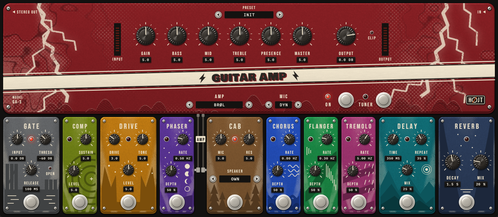
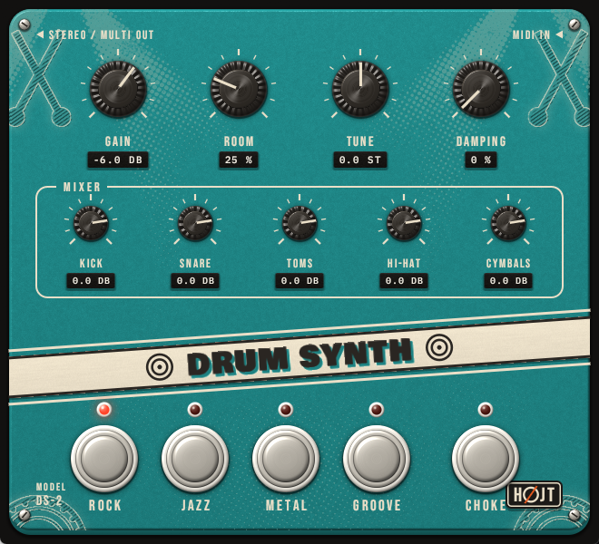
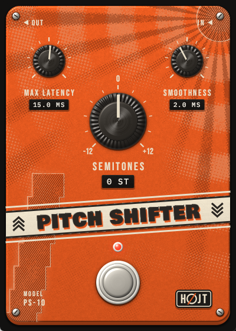

# HØJT Audio

Free audio plugins for guitar, drums, bass and keys, each drawn as a stompbox. VST3 and CLAP, for Windows,
macOS and Linux. HØJT is Danish for loud, and for high.

**[The page, with sound examples and downloads](https://hojte.net/hojt-audio/)** ·
**[Latest release](https://github.com/FrankDrebin893/hojt-audio/releases/latest)**

[](https://hojte.net/hojt-audio/#guitar-amp)

| | |
|---|---|
| [](https://hojte.net/hojt-audio/#drum-synth) | [](https://hojte.net/hojt-audio/#pitch-shifter) |

## The plugins

**Guitar Amp** (`plugins/amp`). A whole rig: four amps of our own design, each with its own
cabinet (Klar: clean, Brøl: crunch, Torden: high gain, Glød: warm, at the edge of breakup), and
ten pedals that can be dragged into another order: gate, compressor, overdrive, phaser, chorus,
flanger, tremolo, cabinet, delay and reverb. The cabinet is heard through a dynamic, ribbon or
condenser microphone, or is your own impulse response. It has presets, a tuner and level
meters, and adds 0.1 to 0.3 ms of latency.

**Drum Synth** (`plugins/drums`). A full drum kit with no samples: every sound is made in the
plugin. Four kits (Rock, Jazz, Metal, Groove), General MIDI drum map, a hi-hat that follows an
electronic kit's pedal, and velocity that changes the sound and not only the level. Besides the
stereo mix it has six stereo outputs, one per group, for a host with multi-out.

**Pitch Shifter** (`plugins/pitch_shifter`). Shifts a guitar by -12 to +12 semitones for live
playing. The delay follows the note being played: about 12 ms on the low E string, under 3 ms
high up the neck.

**Bass Synth** (`plugins/bass`). A plucked string bass, one note at a time, with two voices:
Metal is picked, Groove is played with a finger and slides between notes that overlap.

**Shimmer Pad** (`plugins/pad`). A slow ambient pad of detuned saws and breath, with a chorus
and a large hall whose tail comes back an octave up.

**Glass Bells** (`plugins/bells`). Soft glassy bells with a ping-pong delay and a hall.

The latest release (0.1.0) has the Guitar Amp, Drum Synth and Pitch Shifter as they were then.
Bass Synth, Shimmer Pad, Glass Bells and everything under `Unreleased` in
[CHANGELOG.md](CHANGELOG.md) come with the next release, and can be built from source now.

## Install

Download the zip for your system from the [page](https://hojte.net/hojt-audio/)
or the [latest release](https://github.com/FrankDrebin893/hojt-audio/releases/latest), and copy
the `.vst3` or the `.clap` to its folder:

| System | VST3 | CLAP |
|--------|------|------|
| Windows | `C:\Program Files\Common Files\VST3` | `C:\Program Files\Common Files\CLAP` |
| macOS | `~/Library/Audio/Plug-Ins/VST3` | `~/Library/Audio/Plug-Ins/CLAP` |
| Linux | `~/.vst3` | `~/.clap` |

On macOS, run `xattr -dr com.apple.quarantine <the file you copied>` once afterwards. The macOS
and Linux builds come from the build server and have not been tried in a DAW yet.

## Build from source

Requires [Rust](https://rustup.rs/). On Linux also the packages listed in
[.github/workflows/ci.yml](.github/workflows/ci.yml).

```bash
# VST3 and CLAP bundles in target/bundled
cargo xtask bundle pitch_shifter --release
cargo xtask bundle drums --release
cargo xtask bundle amp --release
cargo xtask bundle bass --release
cargo xtask bundle pad --release
cargo xtask bundle bells --release

# Tests
cargo test --workspace

# A plugin's window as a program, without a DAW and without sound
cargo run -p amp --features standalone -- --backend dummy
```

On Windows, `scripts/install.ps1` builds the VST3 bundles from your checkout and installs them
(all six, or name some: `scripts/install.ps1 amp drums`). Close the DAW first.

The plugins are written in Rust on [NIH-plug](https://github.com/robbert-vdh/nih-plug).
[AGENTS.md](AGENTS.md) describes the suite, and `plugins/<name>/AGENTS.md` how each plugin works,
its parameters and the tools for working on its sound. [CHANGELOG.md](CHANGELOG.md) says what
changed in each release.

## Licence

Copyright (c) 2026 Rasmus Højte. Free software under the
[GNU General Public License](LICENSE), version 3 or later. The name HØJT and its logo are not
part of that licence, and third-party components keep their own: see [NOTICE.md](NOTICE.md).
